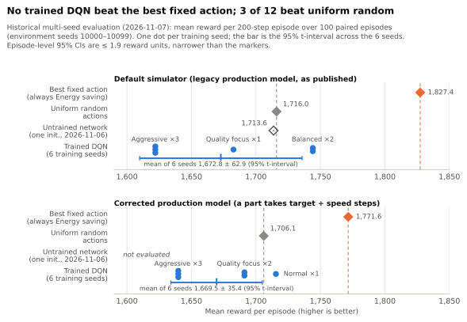

# DQN policy to IEC 61499 function block, checked state by state against the network

A trained DQN is exported as an IEC 61499 function block, and a float32 interpreter executes the generated code: an export is kept only if it reproduces the network's Q-values, actions and setpoints on every sampled state. EAE's type compiler checks acceptance, not behaviour; nothing has run on a controller, and the DQN itself does not beat a fixed-action baseline.

<picture>
  <source media="(prefers-color-scheme: dark)" srcset="docs/figures/fig1_export_verification-dark.svg">
  
</picture>

**Figure 1.** The `.fbt` of 18 networks (13 trained, 5 untrained) run on 20,000 sampled states each, and the `.st` of 1 network; frozen weights, measured 2026-11-08. Agreement on sampled states is not proof for every input. Data: [export_verification.json](docs/data/export_verification.json), [plotted values](docs/data/fig1_export_verification.csv).

| Measured 2026-11-08, frozen weights | Result | Sample |
|---|---|---|
| Q-values, generated `.fbt` against PyTorch | 18 of 18 networks within 10⁻³; worst 7.3×10⁻⁴ | 20,000 sampled states per network, float32 interpreter |
| Action and setpoints, strict gate | 17 of 18 networks identical on every sampled state | tie tolerance 0 |
| The rejected network, `speed_proportional_seed5` | another action and its setpoints on 2 of 20,000 states, with every Q-value within 10⁻³: a Q-only check would have accepted it | [the two states](docs/EVIDENCE.md#6-the-two-rejected-states) |
| Injected defects | 10 of 10 rejected | 5 kinds × 2 networks |
| IEC 61131-3 `.st`, same interpreter | run for 1 of 18 networks (the server run): Q-values bit-identical to its `.fbt` | the other 17: not run |
| EAE 25.0 FBTypeCompiler | 2 of 2 `.fbt` exports accepted with no unfiltered errors or warnings; 3 of 3 broken files rejected | acceptance only, not execution; [raw messages kept](docs/EVIDENCE.md#7-compiler-diagnostics-raw-against-classified) |
| Execution and cycle time on a controller | not verified | |
| **Historical, 2026-11-07** | | |
| Trained DQN against the best fixed action | below it in 12 of 12 training runs | 6 seeds × 2 simulator versions |
| Trained DQN against uniform random actions | above it in 3 of 12 runs | 100 paired episodes each |

**Evidence:** [provenance, commands and hashes](docs/EVIDENCE.md) · [reproduce](#reproduce) · [policy evaluation](#policy-evaluation) · [the near-tie](#the-near-tie-the-gate-caught) · [coverage](#verification-coverage) · [limitations](#limitations-and-deployment-boundary)

## Architecture and verification boundary

| Component | Role |
|---|---|
| [`backend/rl_agent.py`](backend/rl_agent.py) | DQN (12-128-128-128-6 MLP) and `AutomationEnvironment`, a 12-variable stochastic process simulator with 6 setpoint actions |
| [`backend/main.py`](backend/main.py) | FastAPI server: training, `POST /api/code/generate`, WebSocket telemetry for the dashboard [`wmg-digital-twin.html`](wmg-digital-twin.html) |
| [`backend/iec61499_exporter.py`](backend/iec61499_exporter.py) | Writes the `.fbt` and `.st`: weights as `REAL` arrays, float32 forward pass, argmax (first maximum, as `torch.argmax`), setpoint table |
| [`backend/st_interpreter.py`](backend/st_interpreter.py) | Executes the generated ST: `REAL` = float32 with every operation rounded, strict IEC typing, IEC 61499 event, `WITH` and ECC semantics |
| [`backend/eae_fbtype_compiler.py`](backend/eae_fbtype_compiler.py) | Runs EAE's `FBTypeCompiler.exe`, keeps every message line, and separates the messages every standalone compile prints from real errors and warnings |

Every export goes through the same gate, `iec61499_exporter.verify_fbt`, which executes the `.fbt` in the interpreter. On every sampled state it requires max |ΔQ| below 10⁻³, the network's action, and that action's setpoints. The tie tolerance is 0, so no action difference is excused. The server applies the gate on each generation; a failing function block returns HTTP 500 and its files are deleted. Inside the boundary are network-to-code agreement on sampled states, measured in software, and acceptance by EAE's FB type compiler. Outside it are import into an EAE solution, execution on a controller, cycle time, I/O mapping and any plant connection.

## Policy evaluation

<picture>
  <source media="(prefers-color-scheme: dark)" srcset="docs/figures/fig2_policy_evaluation-dark.svg">
  
</picture>

**Figure 2.** Historical results, not re-run: the multi-seed evaluation of 2026-11-07, with 6 training seeds × 2 simulator versions and 100 paired episodes (environment seeds 10000–10099). The untrained network comes from the 2026-11-06 run on the same episodes. The simulator is synthetic, not a validated plant model. Data: [plotted values](docs/data/fig2_policy_evaluation.csv).

The evaluated DQN did not beat the best fixed action under either simulator version. Episode-level 95% CIs are below 2 reward units for every policy; the ± values are 95% t-intervals across 6 training seeds, which is where the uncertainty is.

| Policy | Default simulator | Corrected production model | Evidence |
|---|---|---|---|
| Best fixed action (always Energy saving) | 1,827.4 | 1,771.6 | multi-seed, 2026-11-07 |
| Uniform random actions | 1,716.0 | 1,706.1 | multi-seed, 2026-11-07 |
| Untrained network (one initialisation) | 1,713.6 | not evaluated | single run, 2026-11-06 |
| Trained DQN, 6 training seeds | 1,672.8 ± 62.9 | 1,669.5 ± 35.4 | multi-seed, 2026-11-07 |
| Trained DQN, server run (the network in the export checks) | 1,682.6 | not evaluated | single run, 2026-11-06 |
| *Historical:* original template generator, replaced by the exporter | 1,622.0 | not evaluated | single run, 2026-11-06 |

The original generator (`backend/plc_generator.py`) ignored the network weights. Its code chose "Aggressive" in every state and agreed with the trained network on 0% of states.

## The near-tie the gate caught

<picture>
  <source media="(prefers-color-scheme: dark)" srcset="docs/figures/fig3_near_tie_rejection-dark.svg">
  
</picture>

**Figure 3.** The 2 of 20,000 sampled states on which the strict gate failed `speed_proportional_seed5`, measured 2026-11-08. Both are uniform draws from [−2, 2]¹², not simulator rollouts. Full-precision values: [the two states](docs/EVIDENCE.md#6-the-two-rejected-states), [CSV](docs/data/near_tie_states.csv), [regression fixture](tests/fixtures/near_tie_speed_proportional_seed5.json).

The verification gate caught an action mismatch that Q-value checks alone would have accepted. At these two states the network's best two actions, Quality focus and Aggressive, are 1.22×10⁻⁴ apart: 4 and 2 float32 ulps at Q-values near 456 and 705. The generated Structured Text adds the same products in a different order from PyTorch, the two Q-values round to exactly the same float32 number, and its argmax keeps the first maximum, Aggressive. Nearly equal Q-values do not mean equal behaviour. Aggressive sends speed, pressure and temperature setpoints of 1.20, 1.10 and 1.10 times nominal, against 1.10, 1.05 and 0.95 for Quality focus. Yet every Q-value of this network is within 10⁻³ of PyTorch (worst 7.3×10⁻⁴), so a check of the Q-values alone would have passed it.

The default stays strict by decision: a function block is kept only if it picks the network's action on every sampled state. At a gap this small the action depends on summation order; PyTorch's own Q-values for these states move by up to 1.2×10⁻⁴ with batch size, although it picks Quality focus at each batch size tried. A diagnostic re-check with an explicit tie tolerance of 2×10⁻³ counts both states as near-ties and passes. The generated action and setpoints still differ there, so that re-check is neither evidence of equivalent behaviour nor a strict pass. Four tests in [`tests/test_iec61499_exporter.py`](tests/test_iec61499_exporter.py) pin the case: the generated outputs bit for bit, the strict verdict against PyTorch's recorded outputs, the rejection on the 20,000 measured states, and the strict server default.

## Verification coverage

<picture>
  <source media="(prefers-color-scheme: dark)" srcset="docs/figures/fig4_verification_coverage-dark.svg">
  
</picture>

**Figure 4.** What the checks exercised on 2026-11-08: numerical, action and setpoint checks on 18 networks × 20,000 sampled states; the `.st` file on 1 network and the vendor compiler on 2; 10 injected defects; 3 deliberately broken files. Nothing ran on a controller. Data: [plotted values](docs/data/fig4_verification_coverage.csv).

The trained policies choose one or two actions over all 20,000 states, so on them the action check is weak. On the server-run network it catches 1 of the 5 injected defects, and the Q-value and setpoint checks catch the other four. The untrained networks use all six actions between them, which exercises the argmax and every row of the setpoint table. For the server-run network the IEC 61131-3 `.st` gives Q-values bit-identical to the `.fbt`. The `.st` is checked by the interpreter only, because EAE's FBTypeCompiler does not take raw `.st` files.

## What did not work

- **Every trained policy collapsed to one action** in all states visited during evaluation (12 of 12). Which action depends on the seed: Aggressive, Quality focus, Balanced or Normal. None chose Energy saving, the best fixed action under both production models.
- **The ranking sits inside the error.** By the end of training, the server run's TD error is about 10 times the mean margin between its two best actions, so the greedy choice carries little information ([supporting diagnostic](docs/TRAINING_DIAGNOSTIC.md)).
- **The training budget is small:** one gradient step per 200-step episode, 1,000 updates in total.
- **The simulator limits interpretation.** By default, slower settings finish parts faster (each step adds 1/speed to the cycle counter). A corrected speed-proportional model, now selectable, does not change the outcome.

What was learned: compare a policy with fixed-action baselines before exporting it. And check more than the Q-values and more than the argmax: a collapsed policy makes action agreement almost uninformative, and a near-tie makes Q-value agreement insufficient.

## Reproduce

Python 3.11. On 2026-11-08 the commands below, except `pip install`, were run in this repository's existing `.venv` (torch 2.1.0+cpu, numpy 1.24.3, matplotlib 3.7.2). A clean install has not been re-tested.

```bash
pip install -r requirements.txt
python scripts/export_iec61499_fb.py visual_outputs/run/policy_snapshot_20261106_190932.pt --out-dir out --verify 12000
python docs/scripts/measure_export_verification.py   # 18 networks, defects, EAE compiler if installed (~25 s)
python docs/scripts/extract_near_tie_fixture.py      # the two rejected states, checked against the measurement (~15 s)
python docs/scripts/make_figures.py                  # the figures in this README, from stored evidence
python -m pytest tests -k "not during_training"      # 43 tests; the excluded one starts training
```

Adding `--eae-check` also compiles the `.fbt` with EAE's FBTypeCompiler, which needs EAE Buildtime on Windows; without it the compiler tests are skipped. The tie tolerance can only be relaxed explicitly, through `code_generation.tie_tolerance` in `config/config.json`, and a test keeps the default at 0. Commands, seeds, tolerances and hashes are in [docs/EVIDENCE.md](docs/EVIDENCE.md).

## Limitations and deployment boundary

- **Sampled, not exhaustive.** Agreement holds on the 20,000 sampled states per network. It is not a proof for every input.
- **Near-ties outside the sample.** When two Q-values differ by less than float32 summation-order error, the generated code can pick the other action and send that action's setpoints. The strict gate rejects an export where this happens on a sampled state, as it did for 1 of 18 here; on an unsampled state it can still happen.
- **No controller execution.** No function block has been imported into an EAE solution, deployed or timed. Acceptance by the FB type compiler is not evidence of correct execution. The analysis assumes the target computes `REAL` as IEEE 754 binary32 with round-to-nearest; that has not been checked.
- **Inputs are not conditioned.** The function block expects the simulator's dimensionless state (trained range [−2, 2]) and does no scaling or clipping.
- **Not a validated digital twin.** The process model is synthetic: 12 variables, with no link to a plant, PLC or OPC UA server. The 3D robot view is not driven by it.
- **The policy is not worth deploying.** It never beats the best fixed action. The exporter and its checks are the contribution, not the policy.
- **No safety claim and no general IEC 61499 conformance claim** beyond what EAE's FB type compiler checks.

## How this was built

The original application is by Emin Alper Sensoy; the git history records 26 commits from 2025-08-01 to 2025-08-05. The exporter, interpreter, compiler wrapper, tests, evaluation harness, figures and this README were written in November 2026 by Claude Code agents directed by the author, who also made the acceptance decisions recorded in [docs/EVIDENCE.md](docs/EVIDENCE.md), such as keeping the strict tie tolerance. A read-only review by a second AI tool (OpenAI Codex) was requested with the prompt in [`visual_outputs/CODEX_REVIEW_PROMPT.md`](visual_outputs/CODEX_REVIEW_PROMPT.md); its report is not stored in this repository. Every number above comes from a script and a data file in this repository.

## References and licence

- V. Mnih et al., "Human-level control through deep reinforcement learning," *Nature* 518, 529–533 (2015).
- IEC 61499-1:2012, *Function blocks — Part 1: Architecture*. IEC 61131-3:2013, *Programmable controllers — Part 3: Programming languages*.
- IEEE 754-2019, *Standard for Floating-Point Arithmetic*.

Released under the [MIT licence](LICENSE). EcoStruxure Automation Expert is Schneider Electric software and is not included.
