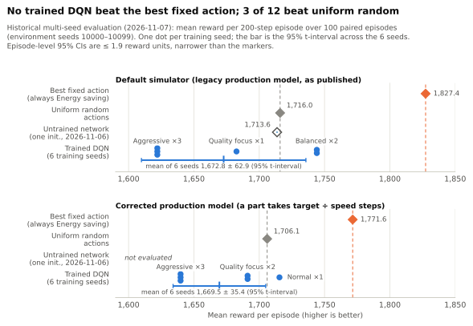

# Evidence and reproduction

The numbers in [README.md](../README.md), where each comes from, and where the evidence stops. Each measurement keeps the date and code revision it was made with. A later replication is reported as a replication and does not relabel the original.

## 1. Code revision and working-tree changes

- Repository: `https://github.com/easensoy/rl-based-digital-twin-automation-code-generator.git`, branch `main`.
- **`.fbt` export check** (morning of 2026-11-08): made on the working tree over `898c112`, before that work was committed. It was committed the same day, one file per commit, ending at `6c895bd`.
- **Standalone `.st` measurement, clean-environment runs and CI emulation** (evening of 2026-11-08): made on the working tree over `6c895bd`, with uncommitted changes. `docs/data/st_verification.json` lists the changed paths at run time. The relevant changes are:
  - `verify_st` added to `backend/iec61499_exporter.py`, with `verify_fbt`'s comparison moved into a shared helper (no line removed or edited);
  - the corpus and tests `tests/st_corpus.py` and `tests/test_st_standalone.py`;
  - test markers (`pytest.ini`) and the skip policy (`tests/conftest.py`).
- SHA-256 of the code. `iec61499_exporter.py` changed between the two measurements; section 8 shows that the refactored `verify_fbt` reproduces every stored `.fbt` verdict.

| File | At the `.fbt` measurement | At the `.st` measurement |
|---|---|---|
| `backend/iec61499_exporter.py` | `9d647826…488b934f` | `a70c9e04…dc629047` |
| `backend/st_interpreter.py` | `9169b62e…fe7e15f5` | unchanged |
| `backend/eae_fbtype_compiler.py` | `b2b48d72…adbd7903` | unchanged |
| `backend/rl_agent.py` | `6aa619a4…bc8e244a` | unchanged |
| `backend/main.py` | `0a7c354e…7bd37447` | unchanged |
| `tests/st_corpus.py` | did not exist | `5ee85c3c…1e97e44e` |

## 2. What kind of evidence each claim rests on

| Kind | What | Files |
|---|---|---|
| **Historical, single run** (2026-11-06) | One training run of the unmodified server (seed 42, 1,000 episodes, 188.8 s), then 100 evaluation episodes per policy. Source of the untrained-network, server-run and old-generator rows, and of the [training diagnostic](TRAINING_DIAGNOSTIC.md). | `visual_outputs/run/evaluation.json`, `visual_outputs/data/training_loss.csv`, `visual_outputs/run/policy_snapshot_20261106_190932.pt` |
| **Historical, multi-seed** (2026-11-07) | Seeds 42 and 1–5, 1,000 training episodes each under both production models, evaluated greedily on the same 100 environment seeds as the baselines (paired). Source of figure 2. | `visual_outputs/run/eval_v2/summary_*.json`, `episodes_*.csv`, `policies/*.pt` |
| **Measured 2026-11-08, `.fbt`** | Export, interpreter run of the `.fbt` and gate on 18 frozen networks; 10 injected defects; EAE compiler on 2 exports and 3 broken variants; the two rejected inputs pinned as a regression fixture. | `docs/data/export_verification.json`, `tests/fixtures/near_tie_speed_proportional_seed5.json` |
| **Measured 2026-11-08, `.st`** | The `.st` on the 18-network corpus and on a 14-network synthetic corpus; the mutation matrix; replication of the `.fbt` verdicts with the refactored gate. | `docs/data/st_verification.json` |
| **Replicated 2026-11-08, clean environment** | Fresh virtual environment and fresh clone of `6c895bd`: install, export command, both measurement scripts' outputs compared with the stored artifacts, figure data, documented tests. Then the CI test selection on the revised tree. | section 10 |
| **Defined, not run remotely** | The GitHub Actions workflow. | section 11 |
| **Test defined, not run 2026-11-08** | `test_code_generation_during_training` (marker `training`). It passed in the full run of 2026-11-07. | `tests/test_iec61499_exporter.py` |
| **Not claimed** | Formal equivalence, target-runtime behaviour, real-time digital twin, plant connection, safety function, IEC 61499 conformance beyond type-compiler acceptance, beneficial learning. | n/a |

Training was not re-run. `visual_outputs/REPORT.md`, `REPORT.html` and `FINDINGS.md` are the 6 November 2026 assessment of `898c112` and now carry a historical notice. Their measurements are unchanged. The 2026-11-06 run evaluated on the same 100 environment seeds as the 2026-11-07 baselines, and its uniform-random and fixed-action results are identical to theirs, so its untrained-network row is comparable with the default-simulator results. The server snapshot is not the network that offline seed 42 produces. `visual_outputs/run/eval_v2/rng_leak_check.json` traces the difference to WebSocket keep-alive pings drawing on Python's global `random` stream during the server run; that cause is likely but not proven end to end.

## 3. Commands executed on 2026-11-08

From the repository root, unless stated otherwise. No server was started and nothing was trained.

| Command | Environment | Outcome |
|---|---|---|
| `docs/scripts/measure_export_verification.py` | `.venv` | 24 s; wrote `docs/data/export_verification.json` (morning) |
| `docs/scripts/extract_near_tie_fixture.py` | `.venv` | reproduced the state-set, checkpoint, weight and `.fbt` hashes and the 2 stored disagreements; byte-identical output on repeated runs |
| `docs/scripts/measure_st_verification.py` | `.venv` | 318 s; corpus A 17/18, corpus B 14/14, mutations 50/50 reachable detected; `.fbt` verdicts replicated 18/18. A second run, after fixing the provenance field (section 8), gave identical results and is the stored file (539 s, slower because other jobs shared the CPU). |
| `python -m pytest tests/test_st_standalone.py -s` | `.venv` | 5 passed (71 s) |
| `STRICT_SKIPS=1 python -m pytest tests -m "not training and not service" -rs` | `.venv` | 47 passed, 2 deselected, 0 skipped (111 s) |
| skip-guard check in a scratch copy of `tests/conftest.py` | `.venv` | an unmarked skip under `STRICT_SKIPS=1` exits 1; a `vendor` skip exits 0; without the variable both exit 0 |
| `docs/scripts/make_figures.py` | `.venv` | 10 SVG + 10 PNG, 4 CSV; SVG element ids fixed by `svg.hashsalt`, so regenerated SVGs are byte-identical |
| `node <dataviz skill>/scripts/validate_palette.js` (calculated) | node | categorical palette passes on `#ffffff` and `#0d1117`; light aqua is 2.8:1, so aqua marks carry labels or a distinct shape |
| WCAG 2 contrast of text and status colours (calculated) | `.venv` | body text ≥ 7.4:1; muted grey only for large text and symbols; status icons ≥ 3.3:1 |
| Visual inspection at 830 px on GitHub's light and dark page colours (qualitative) | browser preview | all figures |
| Clean-environment commands | clean venv | section 10 |

## 4. Environments

| | Existing `.venv` | Clean environment |
|---|---|---|
| OS | Windows 11 Pro 10.0.26200, x86-64 | same machine |
| Python | 3.11.14 | 3.11.14, `venv` created from the same base interpreter, outside the source tree |
| Install | existing | `pip install --no-cache-dir -r requirements.txt` with pip 24.0: 422 s, 86 packages, `pip check` clean |
| Key packages | torch 2.1.0+cpu, numpy 1.24.3, matplotlib 3.7.2, pytest 7.4.3, lxml 6.1.3 | identical; all 86 package versions match the `.venv` |
| EAE Buildtime 25.0 | installed on the machine | the same installation was visible, so `vendor` tests ran |

Transitive dependencies are not pinned in `requirements.txt`. On 2026-11-08 they resolved to the same versions as in the existing `.venv`; a later install may resolve differently.

## 5. Corpora, seeds and references

**Corpus A, export check** (both artefacts): 18 networks × 20,000 inputs, SHA-256 of the binary32 input matrix `2b7cfc12…3e21066`.
- Inputs: 10,000 states of `iec61499_exporter.rollout_states(seed=20261108)` (default simulator, uniform random actions) and 10,000 draws uniform in [−2, 2]¹² (`numpy.random.default_rng(20261108)`).
- Networks: the server snapshot (`d79f4d10…375e2990`), the 12 multi-seed policies, and `DQNNetwork(12, 6)` at `torch.manual_seed(0…4)`, untrained.
- Reference: `rl_agent.DQNNetwork` in eval mode, binary32 on CPU, all 20,000 inputs in one batch.
- Export date pinned to 2026-11-08, so file hashes repeat. Snapshot `.fbt` `5f528b23…701f0d00` (425,597 B), `.st` `c328ec3d…32458963` (491,841 B).

**Corpus B, synthetic `.st` corpus** (`tests/st_corpus.py`): 14 networks × 11,128 inputs, SHA-256 `ad6ac305…`.
- Networks:
  - untrained seeds 0–4;
  - `dominant_action0…5`: untrained seed 0 with +100 on one output bias, about 7× the largest spread of its Q-values over the corpus;
  - `tie_0_1`, `tie_2_4`, `tie_3_5`: output row j set equal to row i, plus +100 on both.
- Inputs:
  - the 4,096 vertices of [−2, 2]¹²;
  - 32 boundary vectors: +0, −0, ±1e−40 (binary32 subnormal), ±2·e_k for each k, and ±10 and ±100 in every component;
  - 5,000 uniform draws and 2,000 rollout states, seed 20261109.
- Reference: a float64 forward pass of the same weights. It is independent of the BLAS kernel's binary32 accumulation order, and it gives identical output rows identical values, so the tie networks tie exactly in the reference.
- Reference actions per action over the corpus: 23,020 / 27,439 / 22,667 / 24,087 / 19,947 / 38,632. The untrained networks alone select all six actions.

## 6. Acceptance predicate and tolerances

`verify_fbt` (for the `.fbt`) and `verify_st` (for the `.st`) return `ok` only when all three checks hold on every input:

1. **Q-values:** max over inputs and actions of |q̂ − q| < `q_tolerance` = 10⁻³.
2. **Action:** the generated `ACTION` equals the first maximum of the reference Q-values, the `torch.argmax` rule.
3. **Setpoints:** `SPEED_SP`, `PRESSURE_SP` and `TEMP_SP` equal the `ACTION_SETPOINTS` row of the reference action, bit for bit as binary32.

The generated code adds each bias after the dot product, as `torch.addmm` does, but accumulates the products in a different order from PyTorch's kernels. On corpus A the Q-values therefore differ by up to 7.3×10⁻⁴, or 6 ulps at |Q| ≤ 1,472.

**Near-ties.** `tie_tolerance`, set in the server under `code_generation.tie_tolerance`, defaults to 0, and then no action difference is excused. Set above 0, it excuses a disagreement only where the generated action's reference Q-value is within the tolerance of the best. Excused inputs are counted in `near_tie_disagreements`. On 2026-11-08 the repository owner decided to keep the default at 0. `test_server_default_keeps_the_strict_gate` checks the default in `backend/main.py`, `config/config.json` and `verify_fbt`.

## 7. The two rejected inputs

Network `speed_proportional_seed5`: checkpoint `visual_outputs/run/eval_v2/policies/speed_proportional_seed5.pt`, SHA-256 `738ba0ca…0fff0b56` (weights `5048b068…3848c02f`). It was trained on 2026-11-07 with seed 5 under the corrected production model. Its export dated 2026-11-08 has `.fbt` SHA-256 `1cdad527…11df174ce`. Both inputs come from the uniform half of corpus A, so they lie inside the simulator's clipping range but are not states it visited.

| | Input 13327 | Input 14848 |
|---|---|---|
| Source | uniform draw 3,327 of 10,000 | uniform draw 4,848 of 10,000 |
| POS_X, POS_Y, POS_Z | −0.7379468, −0.2419244, −1.611551 | 0.9115475, −0.4681237, −1.669782 |
| VEL_X, VEL_Y, VEL_Z | 1.399571, 0.7049694, −1.932122 | −1.210441, 0.07155652, 1.885886 |
| TEMP, PRESSURE, VIBRATION | 1.09585, −1.23343, −1.41869 | −0.604011, −1.779255, −1.609841 |
| LOAD, QUALITY, ENERGY | −1.655823, −1.573928, −1.047497 | −1.016477, 0.5219349, −1.921787 |
| PyTorch Q: Quality focus / Aggressive | 456.453949 / 456.453827 | 704.549011 / 704.548889 |
| PyTorch gap | 1.22×10⁻⁴ = 4 ulps (ulp 3.05×10⁻⁵) | 1.22×10⁻⁴ = 2 ulps (ulp 6.10×10⁻⁵) |
| Generated Q: Quality focus / Aggressive | 456.453918 / 456.453918, an exact tie | 704.548889 / 704.548889, an exact tie |
| Largest \|q̂ − q\| over the six actions | 1.22×10⁻⁴ | 1.83×10⁻⁴ |
| Action: PyTorch → generated | Quality focus → Aggressive | Quality focus → Aggressive |
| Setpoints (speed, pressure, temperature) | 1.10, 1.05, 0.95 → 1.20, 1.10, 1.10 | 1.10, 1.05, 0.95 → 1.20, 1.10, 1.10 |
| Q-only criterion / strict gate | accept / reject | accept / reject |

Inputs are shown to 7 significant digits and Q-values to 6 decimals. The fixture [`tests/fixtures/near_tie_speed_proportional_seed5.json`](../tests/fixtures/near_tie_speed_proportional_seed5.json) holds the inputs and all six Q-values from both sides exactly, with their binary32 bit patterns, and [`docs/data/near_tie_states.csv`](data/near_tie_states.csv) lists the same values with one row per input. The fixture also records the SHA-256 of PyTorch's full 20,000 × 6 reference matrix. The end-to-end test runs only where PyTorch reproduces that matrix bit for bit, and skips otherwise.

PyTorch's own result for these rows depends on the batch they are computed in. In a batch of 2 the gap is 1.53×10⁻⁴ for input 13327 and 6.10×10⁻⁵ for input 14848. Computed one input at a time, it is 9.16×10⁻⁵ and 1.22×10⁻⁴. PyTorch selects Quality focus in every case. A re-check with `tie_tolerance` = 2×10⁻³ passes with both inputs counted as near-ties. The generated action and setpoints still differ there, so this is a diagnostic, not a strict pass.

## 8. Standalone `.st` verification (`docs/data/st_verification.json`)

Stored file: the second run, SHA-256 `20ef916d…9c507c30`. Corpus B inputs: SHA-256 `ad6ac305…`. Corpus A inputs are those of section 5.

- **Corpus A, PyTorch reference.** The `.st` of every network was run on all 20,000 inputs.
  - 17 of 18 networks accepted; `speed_proportional_seed5` was rejected with checks `argmax` and `setpoints` failing on the same 2 inputs as the `.fbt`.
  - Q-values, actions and setpoints were bit-identical to the `.fbt` for all 18 networks and all inputs.
  - Recomputing the `.fbt` verdicts with the refactored `verify_fbt` reproduced the stored values of `ok`, `checks`, `max_abs_q_diff`, `argmax_disagreements`, `near_tie_disagreements` and `setpoint_mismatches` for all 18 networks.
- **Corpus B, float64 reference.** 14 of 14 networks accepted, worst max |q̂ − q| 3.9×10⁻⁶. The checks also confirmed:
  - each `dominant_action` network selects its action on every input and outputs that action's setpoints bit for bit;
  - each tie network's two Q-values are bit-identical in the generated code and in the reference on every input, and the first maximum is selected.
- **Mutation sensitivity, corpus B.** Eight `.st` mutants were each applied to all 14 networks, 112 pairs in all:
  - argmax → argmin;
  - first → last maximum, which changes `>` to `>=`;
  - a SPEED_SP literal changed in the branch of each action.

  A pair counts as reachable when the mutation changes an output: always for argmin, on networks with exact top-two ties in the generated code for last-maximum, and on networks that select the action for a setpoint mutant. 50 pairs are reachable and all 50 are detected; none of the 62 unreachable pairs is detected. By mutant, reachable and detected: argmin 14/14, last-maximum 3/3 (the tie networks), setpoint 0–5: 6, 4, 5, 6, 6, 6.
- **Provenance-field defect, fixed.** In the first run of the script, the first entry of `working_tree_changes` lost its first character, because the git helper stripped the leading space of `git status --porcelain`. The helper now strips only trailing whitespace, and the stored file comes from a second run whose results are identical. The same helper wrote `export_verification.json`; its first `uncommitted_paths` entry was a `__pycache__` line, which the script filters out, so the stored list is complete.

## 9. Compiler diagnostics: raw against classified

`FBTypeCompiler.exe` (EAE 25.0 Buildtime, default options) prints two kinds of message for every standalone compile, including for Schneider Electric's own library type `SE.App2WWW/rotationArrayValidation.fbt`:

- `ERR_XML_SNAPSHOT_GUID_INCONSISTENT`, once per type, because a non-incremental compile has no base snapshot;
- `ERR_SYNTAX: '[...]' is not correct structured text syntax`, once per array `InitialValue`, repeating the whole array (up to about 18 kB).

`eae_fbtype_compiler.classify` puts exactly these into `context_messages`, by matching the `ERR_SYNTAX` text against the file's own initialisers. It treats every other error or warning as a failure. The API returns all three groups as raw lines. Because these known messages are classified out, the README reports "no unfiltered errors or warnings".

| Input | Exit code | Unfiltered errors / warnings | Known messages | Verdict |
|---|---|---|---|---|
| Server snapshot export | 0 | 0 / 0 | 23 (1 + 22 arrays) | accepted, 449,289 B `.bin` |
| Untrained seed-0 export | 0 | 0 / 0 | 23 | accepted |
| Undeclared variable added | 1 | `ERR_NO_SUCH_VAR` / 0 | 23 | rejected |
| `REAL` assigned to `INT` | 1 | `ERR_CAST_UNDEFINED` / 0 | 23 | rejected |
| Weight array one value short | 0 | 0 / `WRN_FBTYPE_XMLPARSER … WRN_ARRAY_NOINIT` | 23 | rejected by the wrapper (the compiler still writes a `.bin`) |

Acceptance means only that the FB type compiler accepted the type. No EAE solution build, deployment or runtime test was done, and the other 16 exports were not compiled. FBTypeCompiler does not take raw `.st` files, and no other IEC 61131-3 compiler was run.

## 10. Clean-environment reproduction

Environment as in section 4, created outside the source tree; the existing `.venv` was only read, to locate its base interpreter.

**Published state.** On a fresh `git clone` of `6c895bd`, in the clean environment:

| Command | Outcome | Compared with the stored artifact |
|---|---|---|
| `pip install --no-cache-dir -r requirements.txt` | exit 0, 422 s, 86 packages, `pip check` clean | — |
| `scripts/export_iec61499_fb.py … --out-dir out --verify 12000` | exit 0 (6 s): 12,000 states, agreement 100.00%, max \|ΔQ\| 5.49×10⁻⁴ | identical to the `.venv` run |
| `docs/scripts/measure_export_verification.py` | exit 0 (45 s) | all 18 networks' `ok`, `checks`, max \|ΔQ\|, agreement, disagreements, action histograms, Q ranges, file hashes and examples identical. `.st` check, 10 mutation results and EAE results identical, ignoring timing. Only `generated_at` and `wall_seconds` differ. |
| `docs/scripts/extract_near_tie_fixture.py` | exit 0 (9 s) | `near_tie_states.csv` identical. The fixture differed only in a field that then copied the measurement's timestamp; the field now names the matched hashes instead. |
| `docs/scripts/make_figures.py` | exit 0 (13 s) | all CSVs identical. SVGs identical once element ids are masked; the ids came from matplotlib's random salt, now fixed. |
| `python -m pytest tests -k "not during_training" -rs` | 43 passed, 1 deselected, 0 skipped (48 s) | the documented command of `6c895bd` |

**Revised tree.** The 40 changed or new paths of the working tree were copied into the clean clone, and the CI steps were run in the clean environment:

| CI step | Outcome |
|---|---|
| `STRICT_SKIPS=1 python -m pytest tests -m "not training and not service" -rs` | exit 0: 47 passed, 2 deselected, 0 skipped (191 s) |
| export command with `--verify 12000` | exit 0: agreement 100.00%, max \|ΔQ\| 5.49×10⁻⁴ |
| `make_figures.py`, then comparison of `docs/data/*.csv` and `docs/figures/*.svg` with the source tree | 15 of 15 files byte-identical after line-ending normalisation |

**Benchmark-v1 increment (2026-11-09).** The clean environment's interpreter was run on the working tree itself, with the benchmark-v1 files and `tests/test_benchmark_v1.py` in place: `STRICT_SKIPS=1 python -m pytest tests -m "not training and not service" -rs` gave 58 passed, 2 deselected, 0 skipped (162 s). The existing `.venv` gave the same counts. The experiment scripts were run in `.venv` only.

Limitations: one machine, one OS and one Python patch version. EAE Buildtime was installed, so `vendor` tests ran rather than skipped, unlike on a CI runner. Network access was used only to install packages.

## 11. Continuous verification

[`.github/workflows/portable-verification.yml`](../.github/workflows/portable-verification.yml) defines the portable path on Ubuntu 22.04 with Python 3.11:

1. Install torch 2.1.0 from PyTorch's CPU wheel index, then `requirements.txt`, then run `pip check`.
2. Run `STRICT_SKIPS=1 pytest tests -m "not training and not service" -rs`. Only `vendor` and `platform_reference` tests may skip.
3. Run the export command with `--verify 12000`.
4. Run `make_figures.py`, then `git diff --exit-code -- docs/data/`.

**Status: locally validated, pending remote execution.** Steps 2–4 ran locally on Windows, in the existing and the clean environment. The workflow file itself, including its Linux CPU-wheel install, has not run on GitHub. On a Linux runner the `vendor` tests will skip, and `platform_reference` will skip unless PyTorch reproduces the recorded binary32 reference.

## 12. Figure sources

All figures are drawn by `docs/scripts/make_figures.py` from stored files only.

| Figure | Inputs | Plotted values |
|---|---|---|
| 1, export and checks (README hero) | `export_verification.json` (`ed28e8ed`), `st_verification.json` | `docs/data/fig1_export_verification.csv` |
| 2, policy evaluation | `eval_v2/summary_legacy.json` (`d49f37f1`), `summary_speed_proportional.json` (`00b8a6d1`), `evaluation.json` (`67be5953`) | `docs/data/fig2_policy_evaluation.csv` |
| 3, the near-tie | `tests/fixtures/near_tie_speed_proportional_seed5.json`, checked against `docs/data/near_tie_states.csv` (`40a8f0b3`) | `docs/data/near_tie_states.csv` |
| 4, coverage | `export_verification.json`, `st_verification.json` | `docs/data/fig4_verification_coverage.csv` |
| Supporting, [training diagnostic](TRAINING_DIAGNOSTIC.md) | `visual_outputs/data/training_loss.csv` (`99f5b9ff`) | `docs/data/supp_td_residual.csv` |

Colours come from the validated palette, with a light and a dark file per figure. Status icons always carry a text label. Text is converted to paths in the SVGs, so they render the same without fonts installed. Figure 2 asserts that the 2026-11-06 run used the same evaluation episodes as the 2026-11-07 baselines before it plots the untrained network beside them.

### Figures of the verification increment

Figures 2-4 were embedded in the README until the benchmark-v1 increment; they are unchanged and are kept here
with their original captions.

<picture>
  <source media="(prefers-color-scheme: dark)" srcset="figures/fig2_policy_evaluation-dark.svg">
  
</picture>

**Figure 2.** Historical results, not re-run: the multi-seed evaluation of 2026-11-07, 6 training seeds × 2 simulator versions, 100 episodes of 200 steps on environment seeds 10000–10099. All policies are evaluated on the same seeds (paired evaluation). The untrained network comes from the 2026-11-06 run on the same episodes. The simulator is synthetic, not a validated plant model. Data: [plotted values](data/fig2_policy_evaluation.csv).

<picture>
  <source media="(prefers-color-scheme: dark)" srcset="figures/fig3_near_tie_rejection-dark.svg">
  
</picture>

**Figure 3.** The 2 of 20,000 sampled inputs on which the strict gate failed `speed_proportional_seed5`, measured 2026-11-08. Both are uniform draws from [−2, 2]¹², not simulator rollouts. Full-precision values: [the two inputs](#7-the-two-rejected-inputs), [CSV](data/near_tie_states.csv), [regression fixture](../tests/fixtures/near_tie_speed_proportional_seed5.json).

<picture>
  <source media="(prefers-color-scheme: dark)" srcset="figures/fig4_verification_coverage-dark.svg">
  
</picture>

**Figure 4.** What the checks exercised, measured 2026-11-08:
- the `.fbt` and the standalone `.st` on 18 networks × 20,000 sampled inputs;
- the `.st` on a synthetic corpus of 14 networks × 11,128 inputs: box vertices, ±0, subnormal and ±100 inputs, simulator rollouts and uniform draws;
- 10 injected `.fbt` defects and 112 `.st` mutant–network pairs;
- 3 broken files for the compiler check.

Nothing ran on a target runtime. Data: [plotted values](data/fig4_verification_coverage.csv), [st_verification.json](data/st_verification.json).

## 13. Dependencies the presented workflow needs

| Need | Packages |
|---|---|
| Export, interpreter, gate | Python 3.11, `numpy==1.24.3`, `torch==2.1.0` (CPU) |
| Figures | `matplotlib==3.7.2` |
| Tests | `pytest==7.4.3`; `fastapi`, `uvicorn` and `starlette` for the in-process server tests |
| DTD test (`vendor`) | `lxml==6.1.3`, pinned on 2026-11-08, plus EAE Buildtime's DTD |
| Compiler checks (`vendor`) | EAE Buildtime 25.0 on Windows |

`requirements.txt` also pins packages this workflow does not use, such as OPC UA, Modbus, Celery and Redis.

## 14. Not verified

- Agreement on inputs outside the sampled corpora; formal equivalence.
- Import of the `.fbt` into an EAE solution, build, deployment to a controller, execution and cycle time.
- Vendor compilation of the `.st`.
- Float behaviour of a target runtime. IEEE 754 binary32 with round-to-nearest is assumed.
- Behaviour outside the simulator's state range, beyond the ±10 and ±100 vectors of corpus B. The function block does not scale or clip inputs.
- Any link to a plant, PLC, OPC UA server or Visual Components model; the 3D view is not driven by the simulator.
- Installation and tests on any configuration other than the one in section 4. The CI workflow has not run remotely.
- Whether PyTorch on other hardware reproduces the recorded reference; the end-to-end near-tie test skips if not.
- The dashboard beyond one manual browser check on 2026-11-07.

## 15. Benchmark-v1 experiment (2026-11-08 to 2026-11-09)

The policy-improvement increment is reported in [experiments/REPORT_v1.md](experiments/REPORT_v1.md) under
the protocol [experiments/PROTOCOL_v1.md](experiments/PROTOCOL_v1.md). It is kept apart from the historical
artifacts. Its files live under `experiments/v1/`, `docs/experiments/`, `docs/figures/v1/`,
`docs/scripts/make_experiment_figures.py` and `tests/test_benchmark_v1.py`. It changed nothing under
`backend/`, `docs/data/` or `visual_outputs/`, and no newly trained policy was deployed into the application.

| Item | Location |
|---|---|
| Protocol, frozen 2026-11-09 00:06 UTC before the first confirmatory run | `docs/experiments/PROTOCOL_v1.md`; its SHA-256 and those of the benchmark, training and calibration code in `experiments/v1/results/protocol_freeze.json` |
| Benchmark version | `experiments/v1/process.py` (v1), `ledger.py`, `scenarios.py`, `controllers.py`, `evaluate.py` |
| Phase 1 audit of the historical environment | `experiments/v1/audit_v0.py` → `results/v0_audit.json`, `results/v0_ledger.csv` |
| Dev calibration and evaluator validation | `experiments/v1/calibrate.py` → `results/calibration.json` |
| Pilot (seed 101, 200 episodes, dev only) | `results/runs/pilot/`, `results/manifest_pilot.json`, `checkpoints/pilot/` |
| Configurations and seeds | `train_dqn.CONDITIONS`, seeds 1-6; each run's JSON in `results/runs/confirmatory/` holds its configuration, dev learning curve, training returns, interactions, updates, wall and CPU time, code hashes and library versions |
| Checkpoints (final, one per run) | `experiments/v1/checkpoints/confirmatory/<condition>_seed<s>.pt`; SHA-256 in each run's JSON |
| Raw per-episode results | `results/episodes.csv.gz`: every controller × held-out nominal, dev, map and fault episode |
| Summaries, contrasts, decisions | `results/confirmatory.json`; tables in `results/summary.md` (generated by `summarize.py`) |
| Selected trajectory (output D) | `results/trajectories/cold_saturation_seed4004076.csv` |
| Decision-boundary audit (output F) | `experiments/v1/boundary_audit.py` → `results/boundary_audit.json`, `results/boundary_audit_disagreements.csv` |
| Figures A-F | `docs/scripts/make_experiment_figures.py` → `docs/figures/v1/`; plotted values in `results/figure_data/` |

Commands, run from the repository root in `.venv` (Python 3.11.14, torch 2.1.0+cpu, numpy 1.24.3) on
Windows 11 with an Intel Core Ultra 7 165H (16 cores, 22 threads), CPU only:

```bash
python experiments/v1/audit_v0.py                         # Phase 1: historical environment and checkpoints
python experiments/v1/calibrate.py                        # dev only: rule grid, best fixed preset, evaluator validation
python experiments/v1/run_training.py --tag pilot --seeds 101 --episodes 200 --workers 18
python experiments/v1/run_training.py --tag confirmatory --seeds 1,2,3,4,5,6 --episodes 1000 --workers 18
python experiments/v1/evaluate_all.py                     # held-out nominal, map, fault families, output D trace
python experiments/v1/boundary_audit.py                   # output F
python experiments/v1/summarize.py                        # results/summary.md
python docs/scripts/make_experiment_figures.py            # figures A-F
python -m pytest tests/test_benchmark_v1.py               # benchmark checks
```

Elapsed wall-clock time per stage:

| Stage | Wall time |
|---|---|
| v0 audit | 366 s |
| Dev calibration (final run) | 12 s; earlier dev calibration runs and grid checks took about 3 min more |
| Pilot | 268 s |
| Confirmatory training | 2,879 s: 42 runs, 18 worker processes, 0 failed |
| Held-out evaluation | 105 s |
| Decision-boundary audit | 617 s |

In total about 75 min, within the 2-hour cap. The confirmatory training used 4.56 h of summed process CPU
time. Per-run wall and CPU times are in each run's JSON and in `results/summary.md`.

Integrity: every confirmatory run recorded the SHA-256 of the benchmark and training code it ran with. All 42
equal the frozen hashes, and every checkpoint matches the SHA-256 in its run record. The protocol's frozen text
can be checked by hashing the file up to the line "None at the time of freezing."; the entries after it were
added after the freeze.
