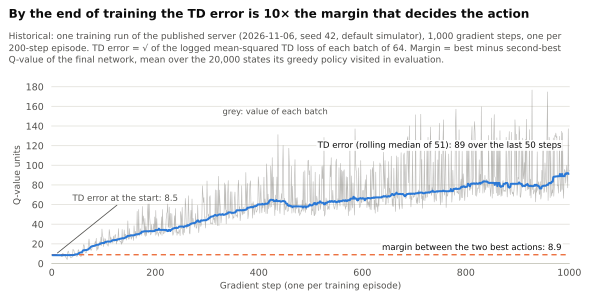

# Training diagnostic: TD error against the action margin

A supporting result for the README's "What did not work" section. It is historical and comes from a single training run.

<picture>
  <source media="(prefers-color-scheme: dark)" srcset="figures/supp_td_error_vs_margin-dark.svg">
  
</picture>

**Supporting figure.** One training run of the published server (2026-11-06, seed 42, default simulator), 1,000 gradient steps, one per 200-step episode. Data: [plotted values](data/supp_td_error_vs_margin.csv), from `visual_outputs/data/training_loss.csv` and `visual_outputs/run/evaluation.json`.

The TD error is the square root of the logged mean-squared TD loss of each batch of 64. Its rolling median rises from 8.5 over the first 50 steps to 89 over the last 50. The final network's best and second-best Q-values differ by 8.9 on average, over the 20,000 states its greedy policy visited in evaluation. The ranking that decides the action is therefore about a tenth of the error the network was trained with, so it carries little information. That is consistent with every trained seed collapsing to a single action. This diagnostic covers one run only; it was not repeated across seeds.
