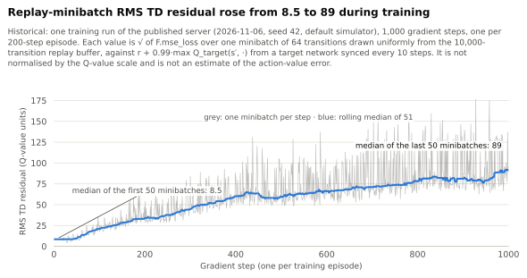

# Training diagnostic: replay-minibatch TD residual

A training log from one historical run. It is reported for completeness and supports no conclusion about the learned policy.

<picture>
  <source media="(prefers-color-scheme: dark)" srcset="figures/supp_td_residual-dark.svg">
  
</picture>

**Supporting figure.** One training run of the published server (2026-11-06, seed 42, default simulator), 1,000 gradient steps. Data: [plotted values](data/supp_td_residual.csv), computed from `visual_outputs/data/training_loss.csv`.

## What is plotted

- **Statistic.** At gradient step *t*, `DQNAgent.replay()` evaluates `F.mse_loss` over one minibatch *B* of 64 transitions drawn uniformly from the replay buffer (capacity 10,000): L_t = (1/64) Σ_{i∈B} δ_i², with δ_i = Q_θ(s_i, a_i) − (r_i + 0.99 · (1 − d_i) · max_a′ Q_θ⁻(s′_i, a′)). Here θ⁻ is the target network, copied from θ every 10 steps. The instrumented server recorded L_t before the optimiser step. The figure shows √L_t, the RMS TD residual of that minibatch, and its rolling median over 51 steps.
- **Corpus.** Replay minibatches only, one per gradient step, one gradient step per 200-step episode. No separate evaluation corpus is involved.
- **Observation.** The median of √L_t over the first 50 minibatches is 8.5, and over the last 50 it is 89.

## Limitations

- A Bellman or TD residual and an action-value estimation error are different quantities. The residual is measured against a bootstrapped target, which moves with θ⁻, and on a sampling distribution that changes as the replay buffer refills. It neither bounds nor estimates |Q_θ − Q^π| or |Q_θ − Q\*|.
- The residual is not normalised by the Q-value scale, which also changed during training. On the 20,000 verification states the final network's Q-values lie between 214 and 1,342, while untrained networks of the same architecture give |Q| < 0.4 ([export_verification.json](data/export_verification.json)).
- Each point is a single minibatch of 64 transitions from a single run.

An earlier version of this page compared the residual with the final network's mean gap between its two best actions. That comparison is withdrawn. The two statistics come from different corpora and different parameters, and no derivation relates them.

## Where the learning-failure conclusion comes from

The [README](../README.md#policy-evaluation) bases it on evaluation, not on this log:

- returns relative to fixed-action baselines on paired evaluation episodes;
- variability between training seeds;
- the observed collapse of every trained policy to a single action in evaluation.
